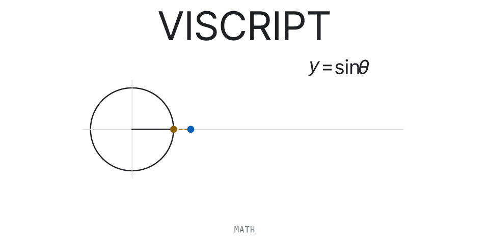
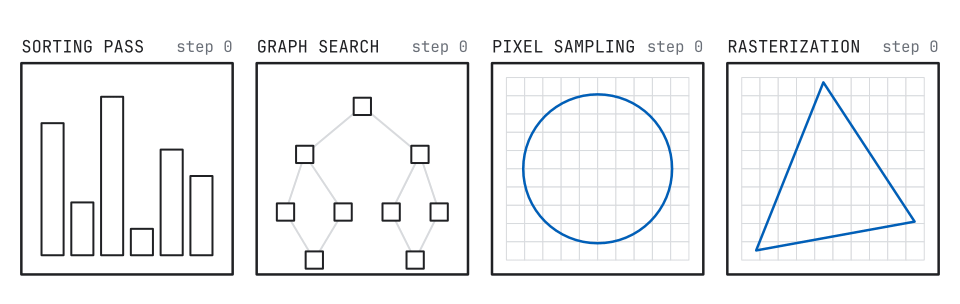
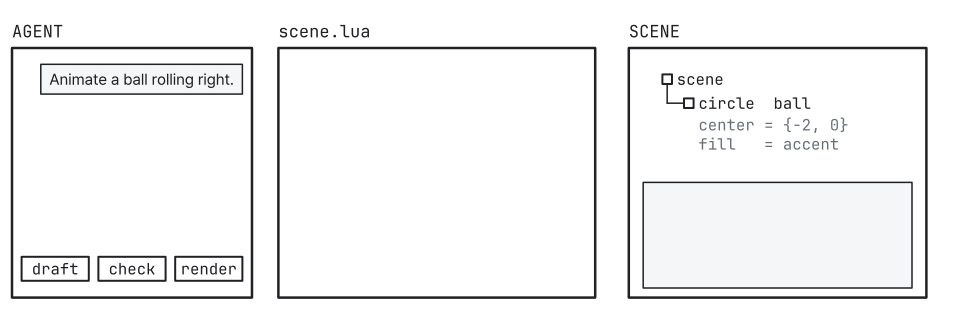
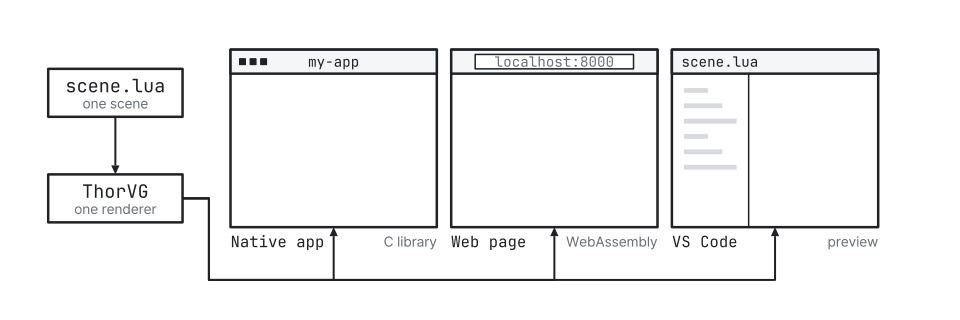
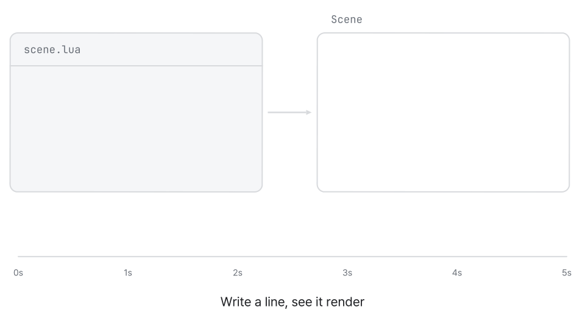
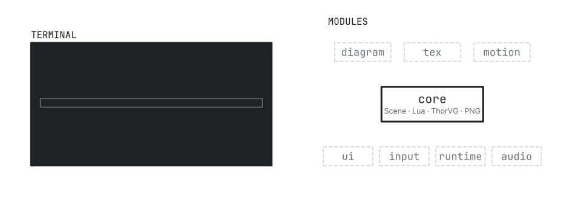
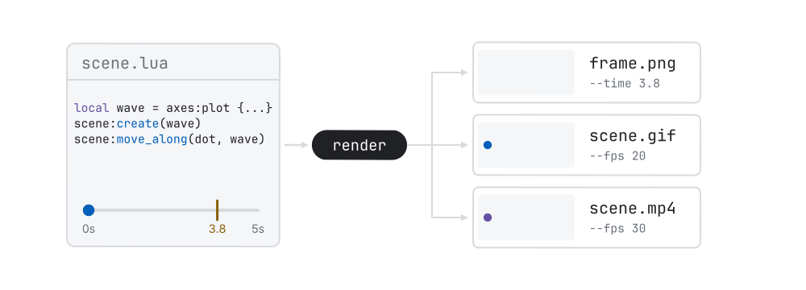
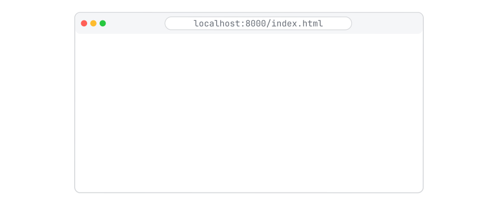
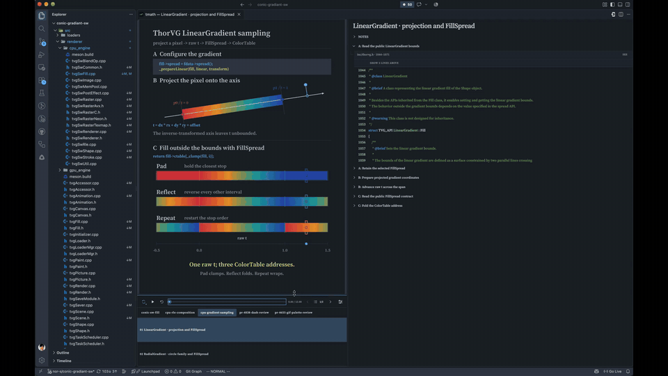
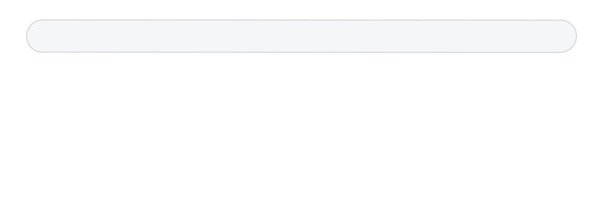

<h1 align="center">
  
</h1>

viscript turns code into animated explanations — algorithms, geometry, and graphics
internals. You describe a scene once in Lua or JavaScript, record animation on a
timeline, and render any moment of it: natively from the command line, live in a web
page, or beside your code in VS Code.

<p align="center"></p>

**Show every step, not just the result.** Sorting passes, graph searches, pixel
sampling, rasterization: animate the intermediate states that static diagrams leave out.

<p align="center"></p>

**Scenes as code, written with AI.** A scene is a retained tree of objects that you
animate by changing properties. Bundled [skills](#skills-for-ai-agents) teach your coding
agent to draft a scene, check its layout, and render it for you to refine.

<p align="center"></p>

**Embed it where you need it.** Link the C library into a native app, load the WebAssembly
runtime in a web page, or preview beside your code in VS Code. One Lua scene, one renderer.

What a scene can hold:

- Shapes, paths, arcs, braces, connectors and vectors
- Text, TeX formulas, syntax-coloured code, matrices and tables, images
- Coordinate spaces with axes and plots, 3D surfaces and voxel fields, cameras and inset views
- Themes, gradients, masks, blend modes, blur and shadow
- Diagrams with automatic layout
- Seekable timelines: transforms, morphs, text animation, trackers, springs, path following
- PNG, GIF and MP4 export

## Quick Start

<p align="center"></p>

```lua
local scene = vis.scene {theme = "pro_white"}

local axes = scene:space {x = {-5, 5, 1}, y = {-2, 2, 1}, stroke = "#00000000"}
local wave = axes:plot {fn = math.sin, x_range = {-5, 5, 0.02}, stroke = "accent", width = 4}
local label = scene:tex {tex = "y = \\sin x", point = {0, 2.4}, size = 36}
local dot = axes:circle {center = {-5, math.sin(-5)}, radius = 0.18, fill = "warning"}

scene:fade_in(axes, {duration = 0.5})
scene:create(wave, {duration = 1.2, curve = "smooth"})
scene:write(label, 0.6)
scene:grow_from_center(dot, 0.3)
scene:move_along(dot, wave, {duration = 2.4, curve = "ease_in_out"})

return scene
```

The same scene in JavaScript:

```js
const scene = vis.scene({theme: "pro_white"});

const axes = scene.space({x: [-5, 5, 1], y: [-2, 2, 1], stroke: "#00000000"});
const wave = axes.plot({fn: Math.sin, x_range: [-5, 5, 0.02], stroke: "accent", width: 4});
const label = scene.tex({tex: "y = \\sin x", point: [0, 2.4], size: 36});
const dot = axes.circle({center: [-5, Math.sin(-5)], radius: 0.18, fill: "warning"});

scene.fadeIn(axes, {duration: 0.5});
scene.create(wave, {duration: 1.2, curve: "smooth"});
scene.write(label, 0.6);
scene.growFromCenter(dot, 0.3);
scene.moveAlong(dot, wave, {duration: 2.4, curve: "ease_in_out"});

return scene;
```

Three ideas carry through every scene:

- **Sizes are pixels, positions are world units.** The camera shows six world units
  vertically unless `camera.height` says otherwise; `width`, stroke widths and font sizes
  are pixels.
- **Calls run on a timeline cursor.** Each animation starts where the previous one ended;
  `wait` holds, and `parallel` runs tracks side by side.
- **The script runs once.** It describes the scene; the host then samples any time `t`,
  in any order — which is what makes scrubbing and export exact.

## Command line

### Build

<p align="center"></p>

```sh
meson setup build
meson compile -C build
meson test -C build --print-errorlogs
```

| Option | Default | Purpose |
|---|---|---|
| `gl` | `false` | The experimental OpenGL renderer module, `vis-gl` with `vis_gl.h`, for native hosts; never in WASM builds. |
| `modules` | none | Optional modules: `diagram`, `tex`, `interactive`, `audio`, or `all`. |
| `tools` | `all` | The CLI and the audit command. |
| `bundled_thorvg` | `false` | Build the pinned ThorVG subproject instead of using the system one. |

Meson uses a system ThorVG 1.2.0 or newer; without one, add `-Dbundled_thorvg=true`.
The scene above uses `scene:tex`, so build it with the TeX module:

```sh
meson configure build -Dmodules=tex
meson compile -C build
```

Optional modules: `diagram`, `tex`, `interactive` (UI, input, states and the retained Lua runtime) and `audio`.

### Render

<p align="center"></p>

Save the Lua scene as `scene.lua`. Text and formulas are measured with the bundled fonts,
so pass them with `--font` (the presets use Pretendard for text and JetBrains Mono for code):

```sh
set -- --font src/examples/assets/Pretendard.ttf --font src/examples/assets/JetBrainsMono.ttf

build/viscript render scene.lua --time 3.8 -o frame.png "$@"   # one frame
build/viscript render scene.lua --fps 30 -o scene.mp4 "$@"     # video
build/viscript render scene.lua --fps 20 -o scene.gif "$@"     # GIF
build/viscript inspect scene.lua "$@"                         # objects and timeline
build/viscript audit scene.lua "$@"                           # layout problems
build/viscript benchmark scene.lua --frames 120 "$@"
```

- **Video:** `.mp4` and `.gif` export run FFmpeg on macOS and Linux, so it must be on `PATH`.
  The native savers do not support these formats on Windows or in WASM. PNG needs nothing extra.
- **Audio:** add narration with `--audio narration.mp3`. A build with the Audio module also
  mixes the scene's own sound cues into the soundtrack.

## Browser

<p align="center"></p>

The repository ships a prebuilt WebAssembly runtime in
[`tools/skill/vis-skills/assets/wasm/`](tools/skill/vis-skills/assets/wasm), so there is
nothing to build. The folder is self-contained: `client.js` (the API),
`vis-wasm.js` + `vis-wasm.wasm` (the engine), fonts and licenses. Copy the whole folder
next to your page as `viscript/`:

```text
my-page/
├── index.html
└── viscript/        ← copy of tools/skill/vis-skills/assets/wasm/
    ├── client.js
    ├── vis-wasm.js
    ├── vis-wasm.wasm
    └── …
```

`index.html` builds the scene in JavaScript and plays it on a canvas:

```html
<!doctype html>
<meta charset="utf-8">
<canvas width="960" height="540"></canvas>
<script type="module">
import {createVis, vis} from "./viscript/client.js";

// Start the runtime without a scene, then register the font text is measured with.
const runtime = await createVis();
const font = await fetch("./viscript/Pretendard.ttf");
runtime.font("Pretendard", await font.arrayBuffer(), "ttf");

// Build and load the real scene.
const scene = vis.scene({theme: "pro_white"});
const title = scene.text({text: "Hello, viscript", point: [0, 1.2], size: 48});
const circle = scene.circle({center: [-2, -0.8], radius: 0.6, fill: "accent", stroke: "accent"});
scene.write(title, 1);
scene.growFromCenter(circle, 0.5);
scene.shift(circle, [4, 0], 1.2, "ease_in_out");
scene.wait(0.5);
runtime.load(scene, "scene.js");

// Play: draw(canvas, time) renders the frame at `time` seconds on the timeline.
const canvas = document.querySelector("canvas");
const start = performance.now();
requestAnimationFrame(function frame(now) {
    runtime.draw(canvas, ((now - start) / 1000) % runtime.duration);
    requestAnimationFrame(frame);
});
</script>
```

To run Lua instead, load its source: `runtime.load(luaSource, "scene.lua")`.

Serve the folder over HTTP — the module fetches `vis-wasm.wasm`, so opening the file
directly will not work:

```sh
cd my-page && python3 -m http.server
```

For many scenes on one page, the shared player in [`tools/player/`](tools/player) adds what a
page needs around the runtime: one render worker for every canvas, loading when a scene is
seen, playback controls and light and dark colours. The documentation site and the Obsidian
plugin use it.

To rebuild the runtime from source, install Emscripten and run `scripts/wasm-bundle.sh`.
It updates both copies: `tools/vscode/runtime/` and `tools/skill/vis-skills/assets/wasm/`.

## VS Code

<p align="center"><a href="docs/assets/thorvg-vscode-gradient-review.mp4"></a></p>

The extension lives in [`tools/vscode/`](tools/vscode). It previews `.lua` scenes beside
the editor with a timeline scrubber, an Inspector, playback ranges and GIF/MP4 export,
and it can link scenes to the code they explain.

Build and install it from the checkout:

```sh
cd tools/vscode
npm ci && npm ci --prefix ../player
npm run package                                # creates vis-preview-<version>.vsix
code --install-extension vis-preview-*.vsix
```

Or press `F5` in `tools/vscode/` to launch an Extension Development Host.

- **Preview:** open a Lua file containing `vis.scene` and click the viscript icon in the
  editor title bar. The viewer refreshes as you edit, even before you save.
- **Scenes linked to code:** keep the scenes and a manifest under `.vscode/vis/` in your
  workspace. `.vscode/vis/visualizations.json` maps each scene to a source file and symbol;
  the extension then shows CodeLens and hover links from that code to its animation.

```text
your-project/
└── .vscode/vis/
    ├── visualizations.json
    └── raster/animations/clip-span.lua
```

See [`tools/vscode/README.md`](tools/vscode/README.md) for the manifest format and viewer controls.

## Obsidian

The plugin in [`tools/obsidian/`](tools/obsidian) plays scenes in notes. It draws
```` ```viscript ```` (Lua) and ```` ```viscript-js ```` code blocks, embedded `.lua` files such
as `![[orbit.lua|480|loop]]`, and `.lua` files opened in a tab of their own with the source
below. Scenes that name no other theme are `adaptive` and follow the Obsidian theme. The plugin
ships the themes' fonts, so scenes look the same on every device; other fonts come from a vault
folder or Fontsource.

```sh
cd tools/obsidian
npm ci && npm ci --prefix ../player
node esbuild.config.mjs --vault /path/to/vault   # builds main.js and copies the plugin into the vault
```

See [`tools/obsidian/README.md`](tools/obsidian/README.md) for options, fonts and settings.

## Skills for AI agents

<p align="center"></p>

[`tools/skill/`](tools/skill) holds agent skills that teach an AI coding agent the
viscript API, its review loop and scene templates. Ask for a scene in plain language and
the agent writes it, checks it and renders it.

| Skill | Path | Use it for |
|---|---|---|
| `vis-skills` | [`tools/skill/vis-skills/`](tools/skill/vis-skills) | Scenes in Lua or JS/TS: animations, diagrams, algorithm traces, 2D/3D graphics, math shorts, cheatsheets. |
| `vis-interactive` | [`tools/skill/vis-interactive/`](tools/skill/vis-interactive) | Interactive scenes: UI, input, fixed-step runtime, audio. |
| `vis-vscode` | [`tools/skill/vis-vscode/`](tools/skill/vis-vscode) | Linking scenes to product code in the VS Code extension (`.vscode/vis/`). |
| `vis-obsidian` | [`tools/skill/vis-obsidian/`](tools/skill/vis-obsidian) | Installing the bundled Obsidian plugin, embedding scene files in notes, fonts and source display. |
| `vis-animation-dev` | [`tools/skill/vis-animation-dev/`](tools/skill/vis-animation-dev) | Changing viscript itself: engine, bindings, builds, tests. |

Link them into your agent's skill folder from the repository root, so they stay current
with the checkout:

```sh
# Claude Code: this project only (.claude/skills), or every project (~/.claude/skills)
mkdir -p .claude/skills
for skill in vis-skills vis-interactive vis-vscode vis-obsidian vis-animation-dev; do
    ln -s "$PWD/tools/skill/$skill" ".claude/skills/$skill"
done

# Codex
mkdir -p ~/.codex/skills
for skill in vis-skills vis-interactive vis-vscode vis-obsidian vis-animation-dev; do
    ln -s "$PWD/tools/skill/$skill" ~/.codex/skills/$skill
done
```

`vis-skills` carries the same prebuilt WASM runtime and fonts in
`tools/skill/vis-skills/assets/wasm/`, so an agent can mount and render scenes in the
browser or Node without building anything; the `viscript` CLI review commands need a
native build. Then ask, for example:

```text
Use vis-skills to animate binary search on a sorted array of 16 numbers.
```

`vis-obsidian` includes a ready-to-install plugin with its WASM runtime and fonts.
It keeps longer scenes in `Animations/<note folder path>/<note name>/*.lua` and
embeds them from notes: `Algorithms/Search.md` uses
`Animations/Algorithms/Search/overview.lua`. Short examples can stay inline.
Install into an existing vault without building:

```sh
node tools/skill/vis-obsidian/scripts/install.mjs /path/to/vault
```

Use `--show-source` to show scripts below note players. In Obsidian, enable
**viscript** under **Community plugins**; the skill covers font and player settings.

## License

viscript is released under the [MIT License](LICENSE).

## Third-party software

| Component | License | Use |
|---|---|---|
| [ThorVG](https://github.com/thorvg/thorvg) | MIT | Renderer |
| [Lua 5.4](https://www.lua.org) | MIT | Scene scripting |
| [miniaudio](https://github.com/mackron/miniaudio) | Public Domain / MIT-0 | Audio module |
| [Noto Sans Math](https://github.com/notofonts/math) | OFL 1.1 | A subset is embedded in the runtime for the math symbols other fonts lack |
| [Pretendard](https://github.com/orioncactus/pretendard) | OFL 1.1 | Bundled font; a subset of Pretendard Std is the runtime's default font, and the docs site ships Pretendard Std |
| [JetBrains Mono](https://github.com/JetBrains/JetBrainsMono) | OFL 1.1 | Bundled font |
| [Source Serif 4](https://github.com/adobe-fonts/source-serif) | OFL 1.1 | Bundled font (runtime bundles and the VS Code extension) |
| [FFmpeg](https://ffmpeg.org) | LGPL/GPL | Optional native GIF and MP4 export, run as an external program; not linked or distributed |

The VS Code extension also bundles gifenc (MIT), Mediabunny (MPL-2.0) and Shiki (MIT);
see [THIRD_PARTY_NOTICES](tools/vscode/THIRD_PARTY_NOTICES.md). The Obsidian plugin also bundles
CodeMirror's legacy modes (MIT); its `main.js` begins with every notice it needs.
