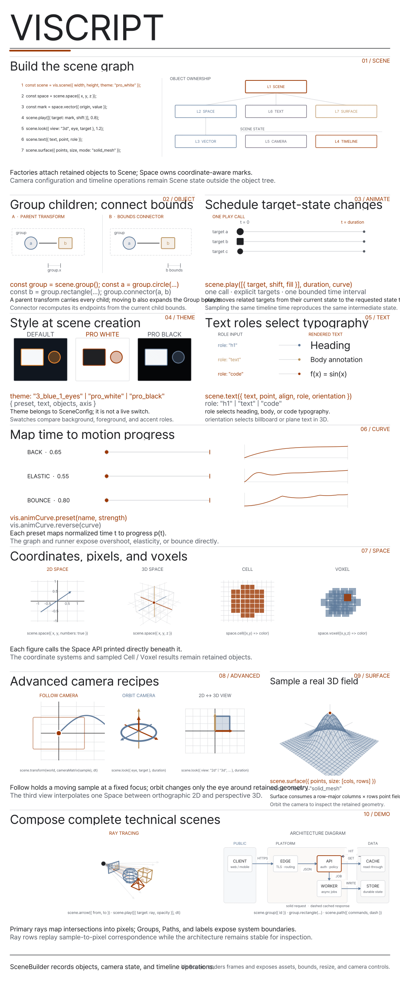

# viscript



viscript is an animation engine for mathematical scenes and diagrams, built on
[ThorVG](https://github.com/thorvg/thorvg). Author a scene in Lua, JavaScript, or C++,
then render it at any time. The same core powers the native CLI, browser runtime,
and VS Code preview.

- Shapes, text, images, coordinate spaces, 3D surfaces, cameras, and themes.
- Seekable timelines with transforms, morphs, trackers, and drawing effects.
- CPU and OpenGL rendering through a retained ThorVG paint tree.
- Optional Diagram, TeX, Motion, UI, Input, Lua Runtime, and Audio modules.
- PNG, GIF, and MP4 export.

## Build

```sh
meson setup build
meson compile -C build
meson test -C build --print-errorlogs
```

| Option | Default | Purpose |
|---|---|---|
| `engines` | `cpu,gl` | Select render engines. |
| `modules` | none | Select modules, such as `diagram,tex`, or `all`. |
| `savers` | `all` | Select GIF and video exporters. PNG is built into core. |
| `tools` | `all` | Select the CLI and audit command. |
| `bundled_thorvg` | `false` | Build the pinned ThorVG subproject. |

The system dependency is ThorVG 1.2.0 or newer. Use `-Dbundled_thorvg=true` to build
the pinned version. See [Modules](docs/modules.md) for build combinations.

With Emscripten installed, run `scripts/wasm-bundle.sh` to build the WASM runtime and
update its copies in `tools/vscode/runtime` and `tools/skill/vis-skills/assets/wasm`.

## Quick start

Save this as `scene.lua`:

```lua
local scene = vis.scene {
    width = 960,
    height = 540,
    theme = "pro_white",
    camera = {mode = "fixed", view = "2d", height = 6},
}

local circle = scene:circle {
    id = "subject",
    center = {-2, 0},
    radius = 0.8,
    fill = "accent",
    stroke = "accent",
}

scene:shift(circle, {4, 0}, 1.2, "ease_in_out")
scene:wait(0.4)
return scene
```

```sh
build/viscript inspect scene.lua
build/viscript render scene.lua --time 0.6 -o frame.png
build/viscript render scene.lua --fps 30 -o scene.mp4
build/viscript render scene.lua --fps 20 -o scene.gif
build/viscript benchmark scene.lua --frames 120
```

Register fonts before loading a scene that measures or draws text. The default
presets use Pretendard for text and JetBrainsMono for code:

```sh
build/viscript render scene.lua -o frame.png   --font src/examples/assets/Pretendard.ttf   --font src/examples/assets/JetBrainsMono.ttf
build/viscript audit scene.lua --font src/examples/assets/Pretendard.ttf
```

MP4 export uses FFmpeg. Add narration with `--audio narration.mp3`. An Audio-enabled
build also mixes the scene's authored cues into the soundtrack. See [Audio](docs/audio.md).

## Source layout

| Path | Contents |
|---|---|
| `src/core/` | Scene, renderer, loaders, savers, Lua binding, and modules |
| `src/inc/` | Public C++ headers |
| `src/cli/` | Command-line tool |
| `src/bindings/` | WASM ABI and JavaScript builder/client |
| `src/test/` | Unit, rendering, and binding tests |
| `src/examples/` | Lua scenes and assets |
| `tools/vscode/` | Preview extension |
| `tools/skill/` | Authoring guides and skills |
| `scripts/` | WASM build and packaging scripts |

## Documentation

- [Architecture](docs/architecture.md) and [Modules](docs/modules.md)
- [Scene composition](docs/scene-composition.md) and [Themes](docs/themes.md)
- [TeX math](docs/tex.md), [Cells and voxels](docs/cell-voxel.md), and [Layout audit](docs/layout-audit.md)
- [Motion](docs/motion.md) and [Audio](docs/audio.md)
- [Lua API](tools/skill/vis-skills/references/lua.md) and [JavaScript API](tools/skill/vis-skills/references/javascript.md)
- [Examples](src/examples/lua) and [VS Code extension](tools/vscode/README.md)
- [MIT License](LICENSE)

## Third-party software

viscript builds on these projects. Binary bundles (`tools/vscode/runtime/`,
`tools/skill/vis-skills/assets/wasm/`) ship their license files; copies also live in
[`licenses/`](licenses).

| Component | License | Use |
|---|---|---|
| [ThorVG](https://github.com/thorvg/thorvg) | MIT | Renderer |
| [libwebp](https://chromium.googlesource.com/webm/libwebp) | BSD-3-Clause | ThorVG WebP loader |
| [LodePNG](https://github.com/lvandeve/lodepng) | zlib | ThorVG PNG loader |
| jpgd | Public Domain | ThorVG JPEG loader |
| [Lua 5.4](https://www.lua.org) | MIT | Scene scripting |
| [miniaudio](https://github.com/mackron/miniaudio) | Public Domain / MIT-0 | Audio module |
| [Noto Sans Math](https://github.com/notofonts/math) | OFL 1.1 | Embedded TeX glyph outlines ([license](src/core/renderer/tvg/NotoSansMath-OFL.txt)) |
| [Pretendard](https://github.com/orioncactus/pretendard) | OFL 1.1 | Bundled font ([license](src/examples/assets/Pretendard-OFL.txt)) |
| [JetBrains Mono](https://github.com/JetBrains/JetBrainsMono) | OFL 1.1 | Bundled font ([license](src/examples/assets/JetBrainsMono-OFL.txt)) |
| [IBM Plex Sans KR](https://github.com/IBM/plex) | OFL 1.1 | Bundled font (runtime bundles) |
| [Source Serif 4](https://github.com/adobe-fonts/source-serif) | OFL 1.1 | Bundled font (runtime bundles) |
| [FFmpeg](https://ffmpeg.org) | LGPL/GPL | Optional MP4 export, run as an external program; not linked or distributed |

The VS Code extension also bundles gifenc (MIT), Mediabunny (MPL-2.0), and Shiki (MIT);
see [THIRD_PARTY_NOTICES](tools/vscode/THIRD_PARTY_NOTICES.md).

## Inspired by

- [Manim](https://github.com/3b1b/manim)
- [Motion Canvas](https://github.com/motion-canvas/motion-canvas)
